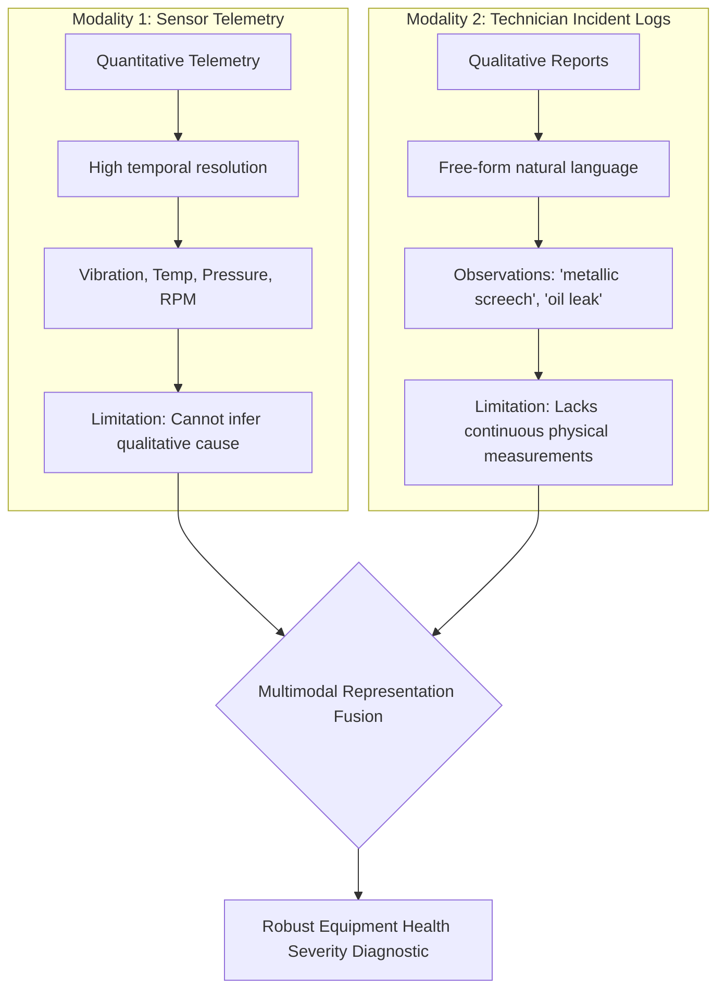
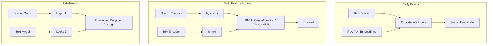
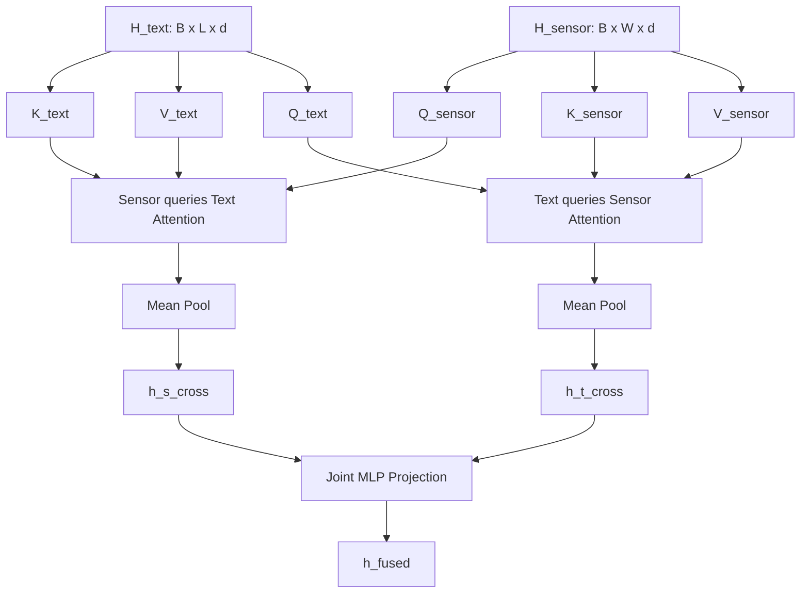

# Multimodal Representation Learning & Fusion Architectures

> **Stage 6 — Multimodal Fusion: Aligning Temporal Telemetry & Free-Form Linguistic Diagnostics**

---

## 1. Motivation: The Complementary Information Hypothesis

In cyber-physical systems (e.g. industrial turbomachinery, aerospace propulsion, critical medical telemetry), single-modality predictors suffer from fundamental epistemic blind spots:



### The Unimodal Dilemma
1. **Sensors Without Context**: A sudden rise in bearing temperature from $45^\circ\text{C} \to 65^\circ\text{C}$ could be caused by normal ambient summer heat, higher planned mechanical load, or catastrophic lubricant breakdown. Without contextual notes, the sensor model must guess.
2. **Text Without Metrics**: A technician log stating *"minor rattling heard in gearbox during morning shift"* describes symptoms, but without sensor telemetry, it is impossible to determine whether the mechanical oscillation is $1.2\,\text{mm/s}$ (safe) or $8.5\,\text{mm/s}$ (imminent destruction).
3. **Multimodal Synergy**: Aligning both data streams enables the system to disambiguate identical numerical patterns using linguistic context, and verify subjective human notes against objective physical measurements.

---

## 2. Multimodal Fusion Taxonomy



### 2.1 Early vs Mid vs Late Fusion

| Strategy | When to Use | Advantages | Vulnerabilities |
|---|---|---|---|
| **Early (Data-Level)** | Highly homogeneous modalities (e.g. RGB + Depth channels). | Maximum cross-modal interaction from step 0. | Fails when modalities differ in sampling rate, dimensionality, or representation (e.g. float arrays vs discrete token IDs). |
| **Mid (Feature-Level)** | Heterogeneous data (e.g. continuous time-series + discrete text). | Specialized encoders extract domain representations before alignment. | Requires careful dimension matching and fusion module design. |
| **Late (Decision-Level)** | Ensembling independently trained specialized systems. | Modular, models can be trained separately. | Zero cross-modal feature representation learning; cannot detect subtle co-occurrences. |

In **EPM Stage 6**, we focus on **Mid/Feature-Level Fusion**, enabling specialized temporal recurrence (BiGRU + 1D Conv) for telemetry and linguistic encoders (Embedding + BiGRU) for incident notes.

---

## 3. Mathematical Formulations of Fusion Mechanisms

Let:
- $h_{\text{sensor}} \in \mathbb{R}^{d}$ be the pooled latent representation from the `SensorEncoder`.
- $h_{\text{text}} \in \mathbb{R}^{d}$ be the pooled latent representation from the `TextEncoder`.

---

### 3.1 Baseline Concatenation Fusion

The most common baseline directly concatenates latent vectors and projects them through a multi-layer perceptron:

$$h_{\text{concat}} = \left[ h_{\text{sensor}} \,\|\, h_{\text{text}} \right] \in \mathbb{R}^{2d}$$

$$h_{\text{fused}} = \text{LayerNorm}\left( W_2 \cdot \text{GELU}\left(\text{LayerNorm}(W_1 h_{\text{concat}} + b_1)\right) + b_2 \right)$$

*Limitation:* Concatenation forces the MLP to learn static weights across all instances. If one modality is corrupted or missing at inference time, the static weights continue feeding garbage through half the input dimensions.

---

### 3.2 Gated Multimodal Unit (GMU) Fusion

The **Gated Multimodal Unit** (Arevalo et al., 2017) introduces an **adaptive gating highway** that dynamically modulates the information flow from each modality per sample:

```mermaid
flowchart LR
    HS[h_sensor] --> TS[tanh W_s h_s]
    HT[h_text] --> TT[tanh W_t h_t]
    
    HS & HT --> CONCAT[Concat]
    CONCAT --> GATE[sigmoid W_z concat]
    
    GATE --> MULT1[z * h_s_tilde]
    TS --> MULT1
    
    GATE --> INV[1 - z]
    INV --> MULT2[(1-z) * h_t_tilde]
    TT --> MULT2
    
    MULT1 & MULT2 --> SUM[+]
    SUM --> LN[LayerNorm]
    LN --> HF[h_fused]
```

#### Mathematical Formulation:
1. **Candidate Latent Projections:**
   $$\tilde{h}_s = \tanh\left(W_s h_{\text{sensor}} + b_s\right) \in \mathbb{R}^d$$
   $$\tilde{h}_t = \tanh\left(W_t h_{\text{text}} + b_t\right) \in \mathbb{R}^d$$

2. **Multimodal Gating Vector:**
   $$z = \sigma\left(W_z \left[ h_{\text{sensor}} \,\|\, h_{\text{text}} \right] + b_z\right) \in (0, 1)^d$$

3. **Gated Convex Combination:**
   $$h_{\text{fused}} = z \odot \tilde{h}_s + (1 - z) \odot \tilde{h}_t$$
   $$h_{\text{out}} = \text{LayerNorm}(h_{\text{fused}})$$

#### Theoretical Properties:
- **Channel-Wise Selectivity**: Each latent feature dimension $j \in \{1, \dots, d\}$ has an independent gate $z_j$. Certain dimensions can track thermal sensor drift while other dimensions track textual keywords.
- **Dynamic Noise Suppression**: When sensor inputs are degraded by electrical noise or missing telemetry, the gate $z \to 0$, routing predictions primarily through the textual pathway.
- **Interpretability**: The scalar average $\bar{z} = \frac{1}{d} \sum_{j=1}^d z_j$ quantifies the model's global reliance on sensor physics versus technician reports for that specific diagnostic decision.

---

### 3.3 Bidirectional Cross-Modal Attention Fusion

While GMU operates on pooled global representations, **Cross-Attention** computes fine-grained token-to-timestep alignments:



1. **Sensor-to-Text Cross-Attention**:
   $$A_{s \to t} = \text{softmax}\left(\frac{H_s H_t^\top}{\sqrt{d}}\right) H_t \in \mathbb{R}^{B \times W \times d}$$
   $$h_{s \to t} = \frac{1}{W} \sum_{w=1}^W \text{LayerNorm}\left(H_s + A_{s \to t}\right)_w$$

2. **Text-to-Sensor Cross-Attention**:
   $$A_{t \to s} = \text{softmax}\left(\frac{H_t H_s^\top}{\sqrt{d}}\right) H_s \in \mathbb{R}^{B \times L \times d}$$
   $$h_{t \to s} = \frac{1}{L} \sum_{l=1}^L \text{LayerNorm}\left(H_t + A_{t \to s}\right)_l$$

3. **Joint Projection**:
   $$h_{\text{fused}} = \text{MLP}\left(\left[ h_{s \to t} \,\|\, h_{t \to s} \right]\right)$$

Cross-attention allows specific words (e.g. *"thermal spike"*) to attend directly to specific timesteps where the temperature derivative peaked.

---

## 4. The Missing & Corrupted Modality Challenge

In mission-critical industrial deployments, complete data is rarely guaranteed:
- **Missing Text**: A catastrophic failure occurs in the middle of the night; no operator had inspected or logged comments yet.
- **Sensor Failure**: A thermocouple melts or pressure sensor disconnects, transmitting zeroed or pure Gaussian noise signals.

To quantify resilience, we define the **Modal Retention Ratio**:
$$\text{Retention}(\mathcal{M}, \text{corrupt}) = \frac{\text{Macro-F1}(\mathcal{M} \mid \text{corrupt})}{\text{Macro-F1}(\mathcal{M} \mid \text{clean})} \times 100\%$$

A robust multimodal architecture should maintain high retention when one modality is compromised, dramatically outperforming static concatenation.
